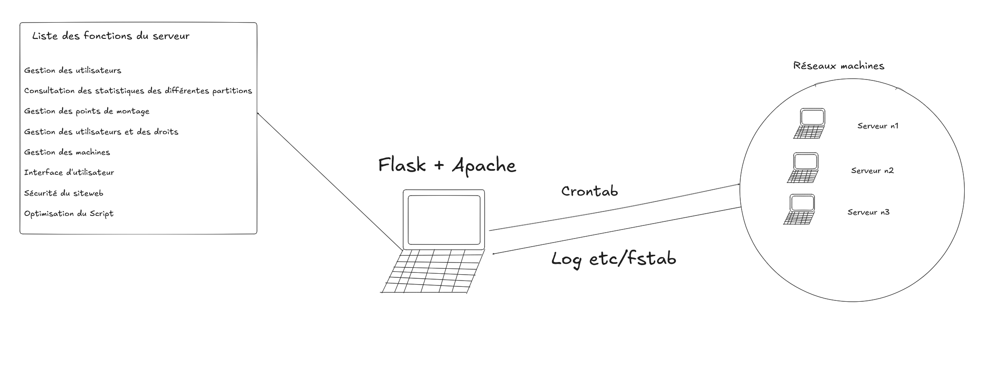

Cette SAÉ est très longue et touche à la programmation orienté objet comme événementielle avec Flask, mais aussi à la mise en place d'un environnement d'entreprise et de sa sécurité.

Le but est de créer une application Web de supervision qui permet de consulter l'état des disques d'un parc de serveur : le fichier `/etc/fstab` va nous fournir la liste des points de montage de chaque machine, la commande `df` va nous fournir quant à elle leurs statistiques d'utilisation telle que les blocs totaux, utilisés et libres etc...


Toutes les informations techniques sont juste au-dessus dans le PDF. 

Je tiens à remercier Monsieur Eric Würbel pour cette SAÉ qui nous apprend rigueur, patience et d'être méthodique, car oui, si on regarde bien, cette SAÉ reste d'un niveau assez poussé sur la variété des domaines.


Pour cette SAÉ, j'ai pensé à une topologie qui ressemblerait à cela : 



Nous avons au milieu notre serveur avec notre serveur Web Flask qui tourne, mais aussi différents programmes qui vont se lancer qui sont des programmes de fonctions Python, par exemple la gestion d'utilisateur dans un fichier puis un autre, etc... Pour faire en sorte que le code principal ne soit pas trop lourd.

À notre niveau d'étude actuel, il faut savoir faire en sorte de proposer des solutions optimisées et d'avoir un esprit critique, c'est pour cela que j'ai imaginé cette topologie et cette façon de faire, mais il est possible que ce ne soit pas la meilleure. Celle-ci peut être menée à changer si je trouve qu'il manque quelque chose ou si une option, un cheminement de pensée s'avère être une erreur de conception.


Pour ce faire, je vais commencer par configurer nos serveurs qui se situent dans le réseau machine.

Je vais utiliser l'image d'une autre SAÉ qui est la SAÉ203 qui était aussi sur de l'administration système. Nous allons faire la configuration réseau mais aussi la création d'un nouvel utilisateur pour notre SAÉ. 


On va donc changer notre fichier /etc/passwd pour créer notre utilisateur. 


Comme nous pouvons le voir, à la fin du fichier j'ai rempli les différents champs demandés par le fichier /etc/passwd. Pour ceux qui ne sont pas habitués, ou pour vous rappeler des champs, voici une liste des champs de /etc/passwd : 


```bash
champs1:champs2:champs3:champs4:champs5:champs6:champs7
utilisateur:mot_de_passe:id_util:id_groupe:gecos:repertoire_util:shell
```


***NB** : le champ gecos est un champ qui sert d'information générale sur l'utilisateur, ce champ ne peut pas contenir les caractères ":" même si celui-ci prend la valeur comme une chaîne de caractères*


Maintenant nous allons créer son groupe, mais aussi son répertoire utilisateur. Pour cela, on fait : 

Création du répertoire utilisateur :

```bash
mkdir /home/sae302
```

Création du groupe : 

Pour la création du groupe il faut se rendre dans le fichier : 

```bash
nano /etc/group
```


À la fin du fichier, nous allons rajouter la ligne : 

```bash
sae302:x:1001:sae302
```

Ici je crée le groupe sae302 et à l'intérieur (le dernier champ) je rajoute l'utilisateur qui se nomme sae302.

À NE JAMAIS FAIRE :

Il ne faut pas changer soi-même le /etc/shadow car cela peut poser des problèmes de syntaxe et donc casser l'authentification, et un champ vide peut permettre à quelqu'un de se connecter sans mot de passe. C'est pour cela que nous allons utiliser `passwd`.


Maintenant que nous avons configuré cela, nous allons rajouter le mot de passe pour notre nouvel utilisateur.

```bash
sudo passwd sae302
```


Maintenant, on va changer de type de configuration. Nous allons faire la configuration réseau de nos machines virtuelles.


Avant de continuer, nous allons régler les droits sur notre répertoire, car sinon l'utilisateur sae302 ne pourra tout simplement pas écrire dans son propre répertoire et cela compliquera notre connexion ssh si on souhaite envoyer des données via ssh.


Pour ce faire, nous allons mettre faire : 
```bash
sudo chown sae302:sae302 /home/sae302
```

Maintenant le répertoire appartient bel et bien à l'utilisateur et au groupe sae302. 

Il faut qu'on gère les droits sur le répertoire, on va donc appliquer les droits suivant : 

 ```bash
 sudo chmod 750 /home/sae302
 ```


On peut remarquer que nos droits se sont bel et bien appliqués.


Voici la configuration du hosts sur notre serveur :


Nous allons rajouter la résolution DNS dans le fichier `/etc/resolv.conf`

Pour ce faire, on fait : 

```bash
sudo nano /etc/resolv.conf
```

Et nous allons rajouter la ligne suivante : 
```bash
nameserver 192.168.122.1
```


Voici le contenu des fichiers de configuration du hostname : 


Voici un type de configuration possible au niveau des adresses IP mais aussi du masque de sous-réseaux et de la passerelle associée.


Dès lors que vous venez de configurer les différents paramètres IP il faut relancer le service "networking". 


```bash
sudo systemctl restart networking
```

Si vous avez des problèmes lors de la relance du service, regardez le journalctl -xeu pour voir l'erreur et vérifiez les 4 paramètres IP, c'est très important ! 


Maintenant il suffit de cloner la VM pour pouvoir avoir les mêmes configuration. Pour ce faire, je vais utiliser l'option graphique en faisant: 

clique droit puis cloner puis je change le nom : 

Attention pour les cloner il faut que les machines soit arrêter. 


Voici à quoi ressemble l'interface graphique pour le clonage depuis qemu. Maintenant il faut savoir que vous n'aurez pas à changer d'adresse MAC puisque lors de la création du clone de la VM celui-ci sera fait automatiquement.

Point à noter, il vous faudra, si vous souhaitez modifier les utilisateurs, repasser par les étapes précédentes pour changer leurs mots de passe, par exemple, mais aussi changer l'adresse IP en faisant comme auparavant nano /etc/network/interfaces

Il faut que toutes les machines aient des IP différentes, si ceci n'est pas respecté, il risque d'y avoir des confusions d'adresse IP et donc cela nous posera des gros soucis.

Prenez en note le fait que chaque système embarque un fichier qui s'appelle machine-id et qui se trouve dans : `/etc/machine-id`, puisque nous clonons nos machines celui-ci peut avoir les mêmes valeurs, si c'est le cas alors la séquence de commande suivante doit être faite pour éviter quelconques problèmes.

```bash
sudo rm /etc/machine-id
```
Ceci permet de supprimer le machine-id actuel. 

Par la suite : 

```bash
sudo systemd-machine-id-setup
```

Pour vérifier que celles-ci sont bel et bien différentes, taper la commande : 

```bash
cat /etc/machine-id
```

Sur toutes vos machines, vous devriez voir celles-ci être différentes des autres.


On peut remarquer qu'après la séquence de commande, les machines-id sont différentes.


Maintenant, il faut savoir que sur nos serveurs, il n'y a pas de serveur ssh qui est déjà configuré ni installé. 

Il va falloir installer sur chacun d'entre eux le serveur ssh pour pouvoir s'envoyer les informations ou même juste pour établir une connexion entre notre serveur central et ceux situés dans la zone des réseaux machines.


Il va falloir donc tout d'abord installer le paquet sur chacun de nos serveurs, mais aussi il va falloir l'installer pour la machine client. Pour ce faire, on fait : 

```bash
sudo apt update && sudo apt install openssh-server
```

Maintenant que le paquet est installé, nous allons créer un utilisateur dédié à la supervision, que nous nommons `supervision`. Il ne détiendra aucun privilège d’administration. Nous nous plaçons en effet dans le contexte d’une entreprise, où les solutions mises en place doivent être sécurisées. Ce compte sera le seul utilisé par le serveur central pour se connecter par clé SSH et lire les informations de disque. Nous procédons ainsi pour limiter les conséquences d’un vol de la clé SSH : l’attaquant qui s’en servirait n’obtiendrait aucun droit d’administration sur le serveur. Il s’agit du principe du moindre privilège, bien connu en cybersécurité et en administration système.

Pour me baser sur le moindre privilège, on va donc restreindre la clé SSH. Par conviction de suivre les recommandations de l'ANSSI, je me suis basé sur leurs PDF open source qui se trouvent sur cette page : https://messervices.cyber.gouv.fr/documents-guides/NT_OpenSSH.pdf

Sinon vous pouvez le suivre sur en dessous. 


Aller dans la rubrique 4.2.2 Séparation des privilèges.