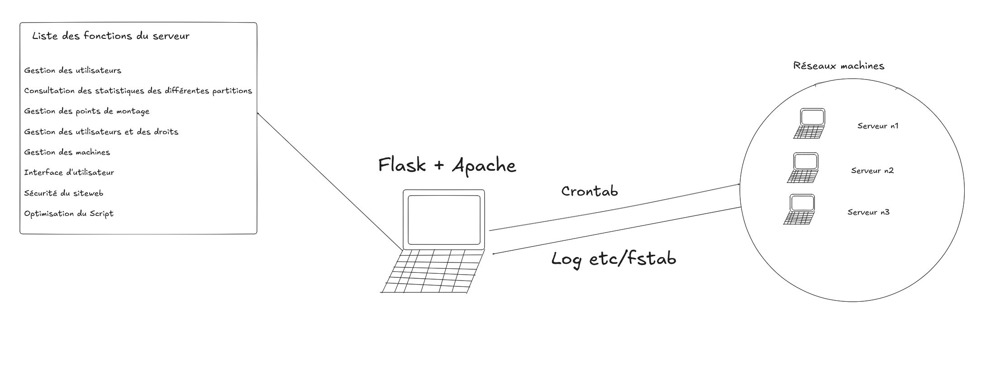

Cette SAÉ est très longue et tous à la programmation orienté objet comme événementielle avec Flask, mais aussi à la mise en place d'un environnement d'entreprise et de sa sécurité.

Le but est de créer une application Web de supervision qui permet de regarder l'état des disques en regardant directement dans le fichier /etc/fstab.


Toutes les informations techniques sont juste au-dessus dans le PDF. 

Je tiens à remercier Monsieur Eric Würbel pour cette SAÉ qui nous apprend rigueur, patience et d'être méthodique, car oui, si on regarde bien, cette SAÉ reste d'un niveau assez poussé sur la variété des domaines.


Pour cette SAÉ, j'ai pensé à une topologie qui ressemblerait à cela : 



Nous avons au milieu notre serveur avec notre serveur Web Flask qui tourne, mais aussi différents programmes qui vont se lancer qui sont des programmes de fonctions Python, par exemple la gestion d'utilisateur dans un fichier puis un autre, etc... Pour faire en sorte que le code principal ne soit pas trop lourd.

À notre niveau d'étude actuel, il faut savoir faire en sorte de proposer des solutions optimisées et d'avoir un esprit critique, c'est pour cela que j'ai imaginé cette topologie et cette façon de faire, mais il est possible que ce ne soit pas la meilleure. Celle-ci peut être menée à changer si je trouve qu'il manque quelque chose ou si une option, un cheminement de pensée s'avère être une erreur de conception.


Pour ce faire, je vais commencer par configurer nos serveurs qui se situent dans le réseau machine.

Je vais utiliser l'image d'une autre SAÉ qui est la SAÉ203 qui était aussi sur de l'administration système. Nous allons faire la configuration réseau mais aussi la création d'un nouveau utilisateur pour notre SAÉ. 


On va donc changer notre fichier /etc/passwd pour créer notre utilisateur. 


Comme nous pouvons le voir, à la fin du fichier j'ai rempli les différents champs demandés par le fichier /etc/passwd. Pour ceux qui ne sont pas habitués, ou pour vous rappeler des champs, voici une liste des champs de /etc/passwd : 


```bash
champs1:champs2:champs3:champs4:champs5:champs6:champs7
utilisateur:mot_de_passe:id_util:id_groupe:gecos:repertoire_util:shell
```


***NB** : le champ gecos est un champ qui sert d'information générale sur l'utilisateur, ce champ ne peut pas contenir les caractères ":" même si celui-ci prend la valeur comme une chaîne de caractères*


Maintenant nous allons créer son groupe, mais aussi son répertoire utilisateur. Pour cela, on fait : 

Création du répertoire utilisateur :

```bash
mkdir /home/sae302
```

Création du groupe : 

Pour la création du groupe il faut se rendre dans le fichier : 

```bash
nano /etc/group
```


À la fin du fichier, nous allons rajouter la ligne : 

```bash

```